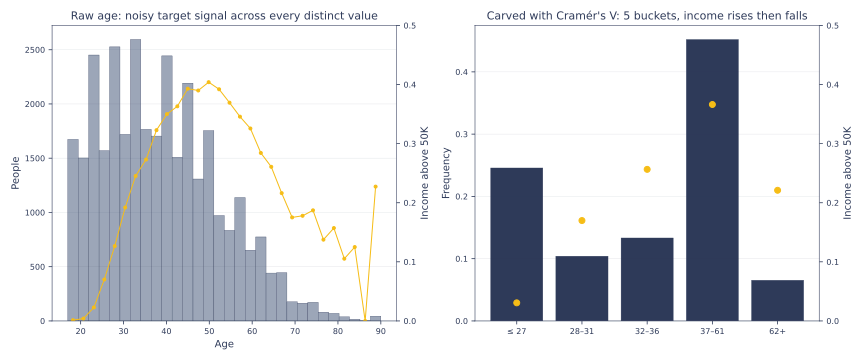

AutoCarver — supervised, robust binning for tabular data
=========================================================

**AutoCarver** turns raw numeric, categorical and ordinal columns into a few
human-readable bins, chosen by their association with your target and kept only if
they hold on a held-out dev sample. One API covers binary, multiclass, ordinal and
continuous targets.

.. code-block:: bash

    pip install autocarver

**Start here:** the :doc:`quick_start` (a runnable Titanic example), then
:doc:`carvers_examples`, and the :doc:`comparison` with optbinning and
``KBinsDiscretizer``.

* **Searched, not eyeballed** — a dynamic-programming search ranks candidate
  groupings by Tschuprow's T (default) or Cramér's V, bias-corrected so that extra
  buckets and small samples don't score by chance (:ref:`stats_bias_correction`).
* **Robust by construction** — a grouping is kept only if its buckets and target-rate
  order hold on a dev sample or cross-validation folds (:doc:`viability`).
* **Auditable** — per-bin statistics, the full carving history, and manual edits that
  ``transform`` applies like any carved bin (:doc:`features`).

.. toctree::
   :maxdepth: 1
   :caption: Introduction

   about
   installation
   quick_start
   comparison
   migration

.. toctree::
   :maxdepth: 1
   :caption: Documentation

   features
   stats
   discretizers
   combinations
   viability
   stability
   carvers
   selectors
   mcp

.. toctree::
   :maxdepth: 1
   :caption: Examples

   carvers_examples
   selectors_examples
   discretizers_examples

